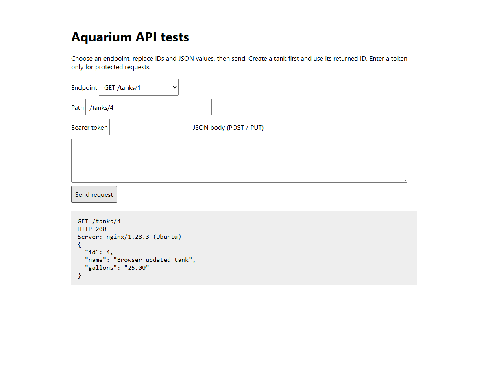

# Aquarium API on NGINX
## Deployment tutorial
Daniel Than · ASE 230 · Project 1

Verified locally in Ubuntu on WSL on October 23, 2026.

---

# Deployment layout
Browser / cURL sends HTTP to port 8088.

NGINX passes the request to PHP-FPM through a Unix socket.

PHP uses PDO to read or update Oracle MySQL on port 3306.

Port 8088 lets this project coexist with the existing port 80 site.

---

# Install and check the tools
```bash
sudo apt update
sudo apt install nginx php-fpm php-mysql mysql-server curl
php -v
mysql --version
nginx -v
```
Verified stack: PHP 8.5.4, MySQL 8.4.11, NGINX 1.28.3.
Use your installed PHP version in the service and pool paths.

---

# Initialize MySQL
From the project root:
```bash
sudo service mysql start
sudo mysql < code/schema.sql
sudo mysql
```
schema.sql creates aquarium_project1 and its three tables.
Run the user creation and GRANT commands in README.md.
Re-importing the schema preserves existing data.

---

# Copy the PHP application
From the project root:
```bash
sudo mkdir -p /var/www/aquarium-project1/code
sudo cp code/* /var/www/aquarium-project1/code/
sudo chmod 755 /var/www/aquarium-project1/code
sudo chmod 644 /var/www/aquarium-project1/code/*
```
NGINX serves test_client.html. API requests go to index.php.
Real credentials remain outside this directory.

---

# Configure a separate PHP-FPM pool
Create /etc/php/8.5/fpm/pool.d/aquarium-project1.conf:
```ini
[aquarium-project1]
user = www-data
group = www-data
listen = /run/php/aquarium-project1.sock
listen.owner = www-data
listen.group = www-data
pm = ondemand
pm.max_children = 4
pm.process_idle_timeout = 10s
```
Use the PHP version installed on your machine.

---

# Set the pool environment variables
Append these to the same pool file:
```ini
env[DB_HOST] = 127.0.0.1
env[DB_USER] = aquarium_project1
env[DB_PASSWORD] = your-database-password
env[API_TOKEN] = your-own-long-token
```
Use the same password as the MySQL account and your own token.
Set the file permissions to 600 with sudo chmod.
Keep real values out of GitHub and the submitted ZIP.

---

# NGINX passes requests to PHP-FPM
The supplied nginx.conf uses:
```nginx
listen 8088;
root /var/www/aquarium-project1/code;
location = /test_client.html { }
location / {
    include fastcgi_params;
    fastcgi_param SCRIPT_FILENAME $document_root/index.php;
    fastcgi_param HTTP_AUTHORIZATION $http_authorization;
    fastcgi_pass unix:/run/php/aquarium-project1.sock;
}
```
Source: NGINX FastCGI module documentation.

---

# Enable and start the site
```bash
sudo cp nginx.conf /etc/nginx/sites-available/aquarium-project1
sudo ln -s /etc/nginx/sites-available/aquarium-project1 \
  /etc/nginx/sites-enabled/aquarium-project1
sudo php-fpm8.5 -t
sudo nginx -t
sudo service php8.5-fpm restart
sudo service nginx reload
```
The symlink command is needed once. Confirm both config tests pass.

---

# Run the full tests through NGINX
```bash
export API_TOKEN='your-own-long-token'
BASE_URL=http://localhost:8088 bash code/test_curl.sh
curl -i http://localhost:8088/tanks
```
Check for All checks passed and a Server: nginx header.
Open http://127.0.0.1:8088/test_client.html in Windows.
The browser client displays the actual response server header.

---



---

# Deployment checks and troubleshooting
- 502: check PHP-FPM is running and the socket paths match.
- 500: check the database account, password, and service.
- 401: use the same token configured in the PHP-FPM pool.
- Connection refused: check NGINX and port 8088.
- Review /var/log/nginx/error.log for server-side details.

To stop the site alone, remove its sites-enabled symlink and reload NGINX.
Full tested results are in presentation/verification.txt.

---

# Sources
- [NGINX FastCGI documentation](https://nginx.org/en/docs/http/ngx_http_fastcgi_module.html)
- [PHP-FPM configuration manual](https://www.php.net/manual/en/install.fpm.configuration.php)
- [MySQL foreign keys](https://dev.mysql.com/doc/refman/8.4/en/create-table-foreign-keys.html)
- [Marp CLI](https://github.com/marp-team/marp-cli)
- Supplied Project 1 requirements and HW3 NGINX exercises Q1–Q2.

The screenshot records the real running local application.
